  <a href="mailto:adityaanand1245@gmail.com">Email</a> ·
  <a href="https://www.linkedin.com/in/aditya-anand-748139226/">LinkedIn</a> ·
  <a href="https://medium.com/@adityaanand1245">Medium</a> ·
  <a href="https://twitter.com/aditya">Twitter</a>

